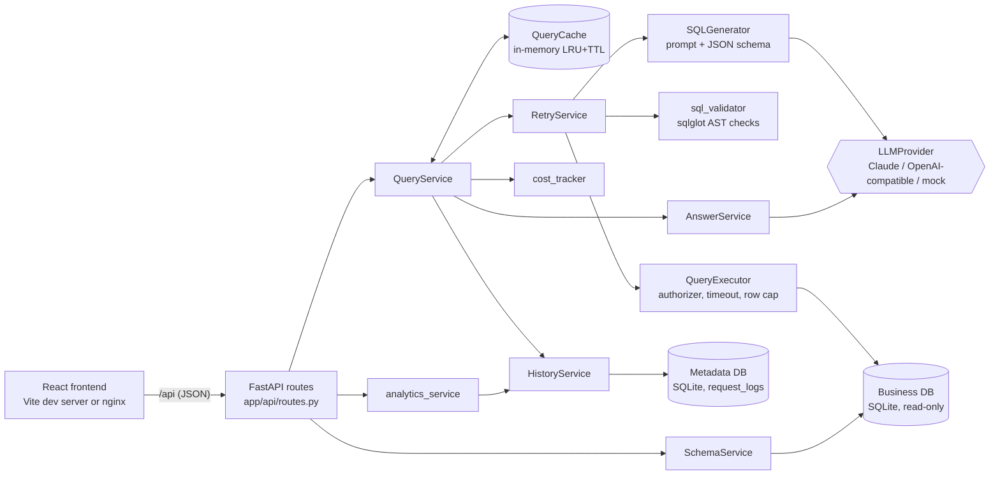
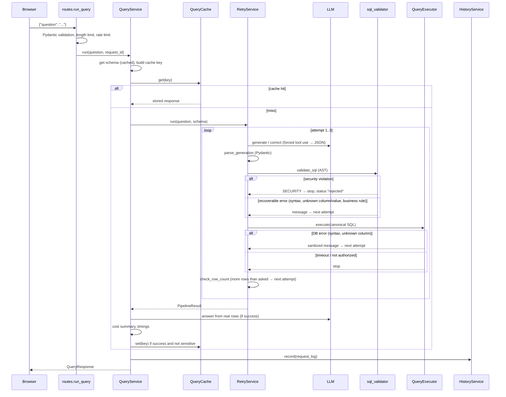

# Architecture

## Components

Two separate databases:

| Database | Opened as | Contains |
|---|---|---|
| `backend/data/business.db` | **read-only** (`mode=ro`, `PRAGMA query_only`, authorizer) | customers, products, orders, order_items |
| `backend/data/querypilot_meta.db` | read-write | `request_logs` (history and analytics) |

Keeping them apart means a bug in history code can never write to business data, and the business connection can have no write permission at all.

## Layers

| Layer | Files | Rule |
|---|---|---|
| HTTP | `app/main.py`, `app/api/routes.py` | Parse/validate input, call one service, return a Pydantic model. No business logic. |
| Wiring | `app/core/container.py` | Builds every service once at startup. Tests inject a fake LLM here. |
| Services | `app/services/*.py` | All behaviour. Each has one job and can be unit-tested alone. |
| Data access | `app/db/database.py`, `app/services/history_service.py` | The only places that create database engines. |
| Config | `app/core/config.py` | All settings from environment variables, typed by Pydantic. |

## Request lifecycle (`POST /api/query`)

### Step by step

1. **Validate the request** — `QueryRequest` (Pydantic) enforces 3–500 characters and collapses whitespace. The route also checks the configurable length limit and the per-IP rate limit.
2. **Request ID** — middleware in `app/main.py` assigns a UUID (or accepts a valid `X-Request-ID` header) and returns it in the response header. The same ID is the history primary key.
3. **Schema** — `SchemaService.get_schema()` returns the inspected schema (cached after the first call) and its version hash.
4. **Cache lookup** — `QueryCache.make_key(...)` hashes normalized question + database identity + schema version + provider + model + row limit + scope.
5. **Generation** — `SQLGenerator.generate()` sends the system rules, the compact schema and the question. Claude is forced to call a `submit_sql` tool whose input schema is `GENERATION_SCHEMA`, so the reply is structured JSON.
6. **Parse** — `parse_generation()` validates the JSON with the `GeneratedSQL` model and strips Markdown fences/semicolons.
7. **Validate** — `validate_sql()` parses with sqlglot and walks the tree (see interview guide for every rule), including checking that values compared with categorical columns really exist. It returns canonical SQL re-rendered from the tree (tested to return identical rows).
7b. **Business rules** — `check_revenue_rule()` rejects revenue computed without the order-status rule.
8. **Execute** — `QueryExecutor.execute()` runs the canonical SQL with the authorizer, a deadline-based progress handler and `fetchmany(max_rows + 1)`.
8b. **Check the result shape** — `check_row_count()` compares the row count with what the question asked for ("top five" → ≤ 5 rows).
9. **Correct** — on a recoverable error, `SQLGenerator.correct()` sends the previous SQL and the sanitized error; the new SQL goes back to step 6.
10. **Answer** — `AnswerService.answer()` writes 1–3 sentences from the first 20 rows (LLM mode) or a template.
11. **Cost** — `summarize_cost()` adds token usage from *every* LLM call in the request.
12. **Store** — successful, non-sensitive results go into the cache; every request (success or not) goes into history.

## Failure outcomes

`POST /api/query` returns HTTP 200 with a `status` field for every *pipeline* outcome, because even failures carry useful detail (attempts, SQL, cost):

| status | Meaning |
|---|---|
| `success` | Validated SQL ran and returned rows (possibly zero) |
| `failed` | Retries exhausted, timeout, or LLM provider error |
| `rejected` | The SQL broke a safety rule; nothing was executed (or the authorizer denied it) |
| `unanswerable` | The model said the schema can't answer the question |

HTTP errors (4xx/5xx) are reserved for problems with the request itself and always use the envelope `{"error": {"code", "message", "request_id", "details"}}`.

## Frontend structure

- `QuerySessionProvider` holds the results of this browser session. The Ask, SQL viewer and Results pages all show the *current* result, so switching pages never re-runs a query.
- `PipelineTrace` renders each attempt as a row of stages (Generate/Correct → Validate → Execute → Answer) with real timings and the exact failure point.
- `ResultChart` only charts real returned rows; `inferChart()` decides line (date + number), bar (label + number) or no chart.
- Pages other than Ask are lazy-loaded so the charting library is only downloaded when needed.
- The browser only calls the backend API. It never sends SQL to a database.

## Scaling notes

| Concern | Today | Next step |
|---|---|---|
| Cache | per-process dict | Redis with the same key scheme |
| Rate limit | per-process sliding window | Redis or API gateway |
| History | SQLite | PostgreSQL (`METADATA_DATABASE_URL`) |
| Business DB | SQLite | PostgreSQL with a SELECT-only role + `statement_timeout` (code path exists, untested) |
| LLM latency | synchronous call in a thread pool | streaming answers, async HTTP client |
