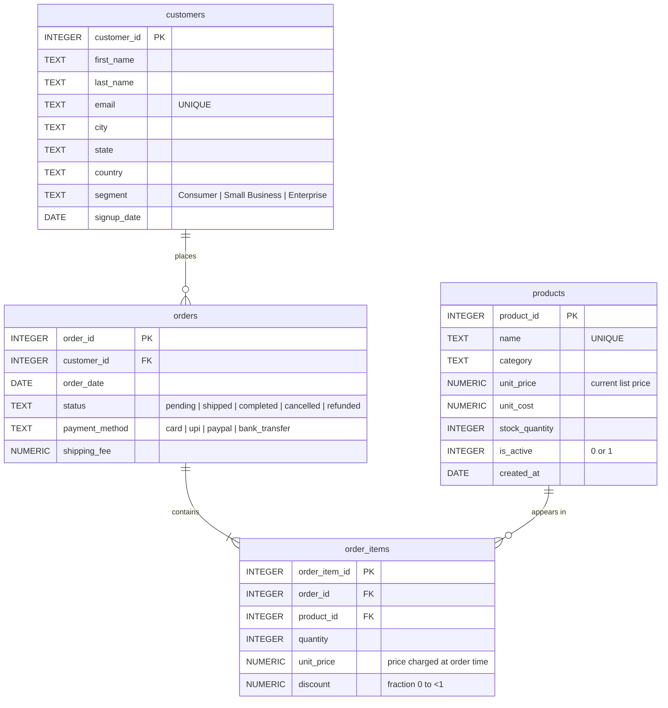

# Database

The sample database is a small online store. It is generated by `backend/app/db/seed.py` with a fixed random seed (42), so every run creates identical data. That matters because the evaluation compares answers with expected results from this data.

```bash
cd backend && python -m scripts.seed_database --force   # rebuild
```

| Table | Rows | What a row is |
|---|---|---|
| `customers` | 150 | A customer account |
| `products` | 40 | A product in the catalogue (4 have never been ordered) |
| `orders` | 1,600 | An order placed by a customer, Jan 2025 – Sep 2026 |
| `order_items` | 3,360 | One product line inside an order |

## ER diagram



## Design decisions

- **`order_items.unit_price` is separate from `products.unit_price`.** Prices change; revenue must use what the customer actually paid. The seed varies the charged price ±5% to make this visible.
- **Revenue excludes cancelled and refunded orders.** This is a business rule the raw schema can't express, so it lives in `app/db/semantic_notes.py` and is sent to the LLM with the schema.
- **CHECK constraints** (`segment`, `status`, `payment_method`, positive prices, discount range) keep the data realistic and give the schema inspector small sets of distinct values to show the model.
- **Indexes** on every foreign key and on `orders.order_date` support the joins and date filters typical questions need.
- **Realistic shape, not uniform noise:** product popularity and customer activity are weighted, order volume grows over time, old pending/shipped orders become completed. Rankings and trends therefore have clear answers.
- **Dates are ISO strings** (`YYYY-MM-DD`), which SQLite's `date()`/`strftime()` functions understand.
- **Money is floating point in SQLite.** `NUMERIC(10, 2)` columns get NUMERIC affinity and values like 79.99 are stored as REAL. Discounts create sub-cent line amounts, so totals can differ from exact decimal arithmetic by a cent on half-cent boundaries (the exact total revenue is 455,614.725; SQLite rounds it to .72). On PostgreSQL, `NUMERIC` is exact.

## Business rules sent to the model

From `app/db/semantic_notes.py`:

- Revenue = `SUM(order_items.quantity * order_items.unit_price * (1 - order_items.discount))` over orders whose status is not `cancelled` or `refunded`.
- Average order value = revenue / number of revenue-counting orders.
- Money is USD, rounded to 2 decimals.
- Relative periods ("last 6 months") are measured from the **data reference date** (the newest order, 2026-09-29), meaning the N most recent calendar months including the reference month. Without this, "last six months" would depend on the day you run the query.

## What the LLM sees

`DatabaseSchema.to_prompt_context()` produces a compact description — structure only, never data rows. For low-cardinality text columns (at most 12 distinct values) it lists the values so the model spells them correctly (`'cancelled'`, not `'canceled'`):

```text
orders(order_id INTEGER PK, customer_id INTEGER FK->customers.customer_id, order_date DATE,
       status TEXT {'cancelled', 'completed', 'pending', 'refunded', 'shipped'}, ...)
  -- One row per order placed by a customer.
  * orders.status: Orders with status 'cancelled' or 'refunded' do not count as revenue.
Business rules:
  - Revenue = SUM(...) over orders whose status is NOT 'cancelled' or 'refunded'.
Data reference date: 2026-09-29 (the newest order). ...
```

The whole schema context is about 2,400 characters (roughly 300 words), so every prompt stays small and cheap.

## Approved tables

Only tables listed in `APPROVED_TABLES` (default: the four above) are inspected, shown in the UI, sent to the model, or readable at runtime. Any other table that exists in the file — and SQLite's internal `sqlite_*` tables — is treated as a security violation if a query references it.

## Metadata database

`backend/data/querypilot_meta.db` has one table, `request_logs` (`app/models/request_log.py`), with one row per `/api/query` call: question, status, error, final SQL, attempts (JSON), timings, tokens, estimated cost, cache hit. Result rows are **not** stored there, because they can contain business data; "Run again" in History re-fetches them.
